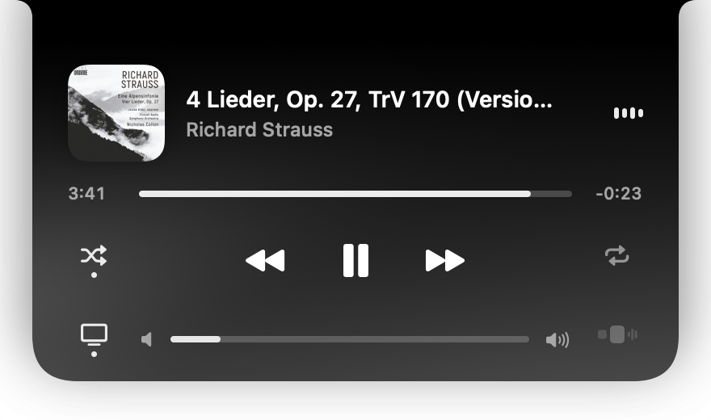

# Notchify

Віджет для вирізу камери на MacBook, який показує, що грає у Spotify, і керує відтворенням.



Поки музика грає, біля вирізу видно «вушка» — обкладинку ліворуч і еквалайзер праворуч:


## Що вміє

- **Плеєр по наведенню.** Наведіть курсор на виріз — відкриється панель: обкладинка, назва, перемотування, пауза, наступний/попередній трек, shuffle, repeat, гучність. Фон панелі підлаштовується під кольори обкладинки.
- **Вушка.** Іконка праворуч від гучності вмикає й вимикає їх. Стан запамʼятовується окремо для музики на цьому Mac і для музики на іншому пристрої.
- **Автоховання.** Якщо Spotify грає на телевізорі, телефоні чи колонці, вушка самі зникають.
- **Вибір пристрою.** Іконка ліворуч від гучності відкриває список пристроїв Spotify Connect і переносить музику на вибраний. Потребує одноразового налаштування (нижче).
- **Автозапуск** при вході в систему — перемикач у контекстному меню.
- **Маскот Claude Code** (необовʼязково) — піксельна істота, яка визирає з-за вирізу, коли Claude Code закінчив відповідь.

## Що потрібно

- MacBook з вирізом камери, macOS 15 або новіша
- застосунок Spotify для Mac
- Xcode Command Line Tools: `xcode-select --install`

## Встановлення

```bash
git clone https://github.com/belkovych/notchify.git
cd notchify
./build.sh run
```

Скрипт збирає `build/Notchify.app` і запускає його. Під час першого запуску macOS спитає дозвіл керувати Spotify — його треба надати.

Якщо на Mac немає сертифіката Apple Development, застосунок підписується локально (ad-hoc). Усе працює, але після кожної перезбірки macOS питатиме дозвіл на Spotify заново.

Правий клік по віджету відкриває меню: вушка, маскот, автозапуск, вихід.

## Вибір пристрою (Spotify Connect)

Список пристроїв Spotify віддає лише через Web API, тому потрібен власний безкоштовний застосунок розробника і Spotify Premium. Це робиться один раз, приблизно три хвилини:

1. На [developer.spotify.com/dashboard](https://developer.spotify.com/dashboard) натисніть **Create app**, у полі API оберіть **Web API**.
2. У **Redirect URI** вставте `http://127.0.0.1:43917/callback`.
3. Скопіюйте **Client ID** застосунку.
4. У віджеті натисніть іконку пристрою, потім **«Вставити Client ID»** (береться з буфера обміну) і **«Увійти в Spotify»**.

Без цього налаштування все інше працює як звичайно.

## Автозапуск

У контекстному меню увімкніть **«Запускати при вході»**. Автозапуск привʼязаний до шляху, де лежить `build/Notchify.app`: якщо перенесете папку проєкту, увімкніть перемикач заново.

## Маскот Claude Code

Маскот іноді визирає сам. Щоб він виходив, коли Claude Code закінчив відповідь, додайте два хуки в `~/.claude/settings.json`:

```json
{
  "hooks": {
    "Stop": [
      { "hooks": [{ "type": "command", "command": "/usr/bin/notifyutil -p local.notchify.claude.done" }] }
    ],
    "UserPromptSubmit": [
      { "hooks": [{ "type": "command", "command": "/usr/bin/notifyutil -p local.notchify.claude.prompt" }] }
    ]
  }
}
```

Вимкнути маскота можна в контекстному меню («Claude визирає»).

## Приватність

Віджет нічого нікуди не надсилає, крім запитів до Spotify: обкладинка треку і, якщо налаштовано вибір пристрою, Web API. Client ID зберігається в налаштуваннях застосунку, токен входу — у звʼязці ключів macOS.

## Як це влаштовано

Нативний Swift/SwiftUI без Xcode-проєкту: `build.sh` викликає `swiftc` напряму.

| Файл | Що в ньому |
| --- | --- |
| `Sources/NotchController.swift` | вікно над вирізом, наведення курсора, розміри |
| `Sources/NotchView.swift` | вушка і панель плеєра |
| `Sources/SpotifyModel.swift` | стан і команди Spotify через AppleScript |
| `Sources/AudioOutputMonitor.swift` | чи йде звук Spotify з цього Mac |
| `Sources/SpotifyConnect.swift` | вхід у Spotify і пристрої через Web API |
| `Sources/DevicesView.swift` | екран «Де грає музика» |
| `Sources/Palette.swift` | кольори з обкладинки |
| `Sources/Mascot.swift` | маскот |
| `Sources/LoginItem.swift` | автозапуск |

## Ліцензія

[MIT](LICENSE) — можна вільно використовувати, змінювати й поширювати.
